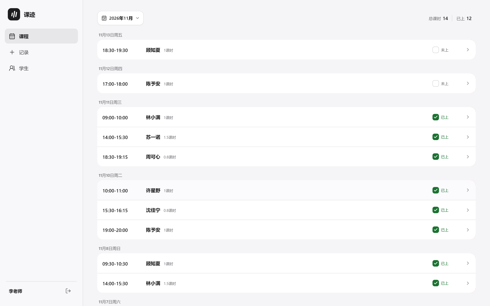
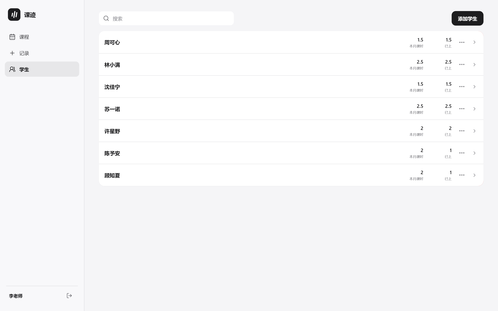
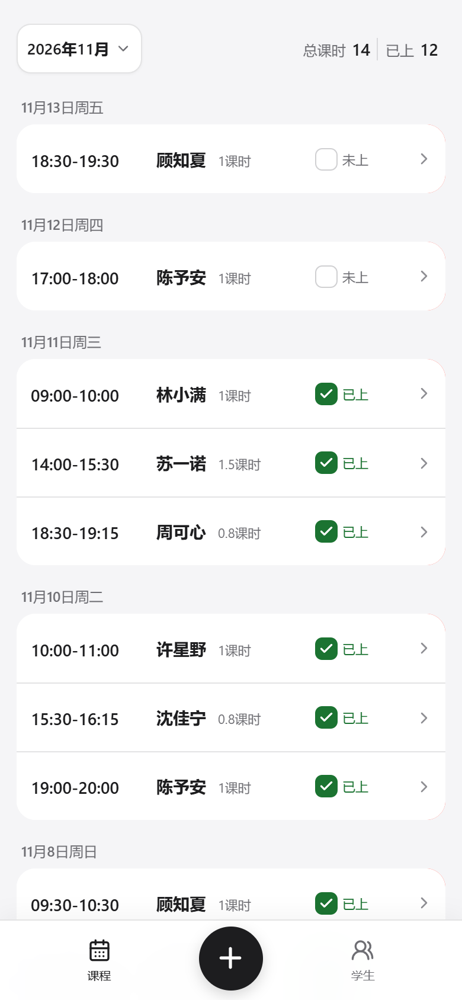
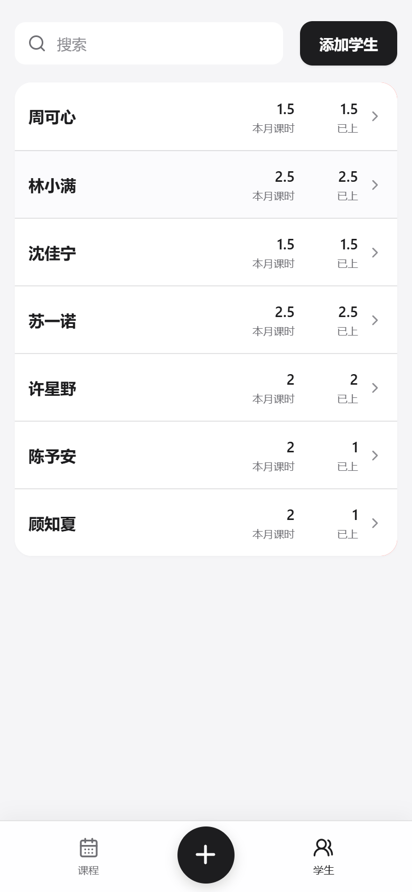

# 课迹

把每一节课记清楚。适合培训机构、工作室和独立老师的课程记录与学员档案工具。

## 界面预览

### 电脑端





### 手机端

<p align="center">
  
  
</p>

## 启动

前端首次运行前安装依赖并构建：

```powershell
pnpm install
pnpm build
go run .
```

打开 <http://localhost:8080>。首次访问会进入注册页。

## 开发

开发时分别启动 Go API 和 Vite：

```powershell
go run .
pnpm dev
```

Vite 会把 `/api` 请求代理到 `http://127.0.0.1:8080`。

## 数据位置

- SQLite 数据库：`data/student-manager.db`

月度边界按 `Asia/Shanghai` 计算。
